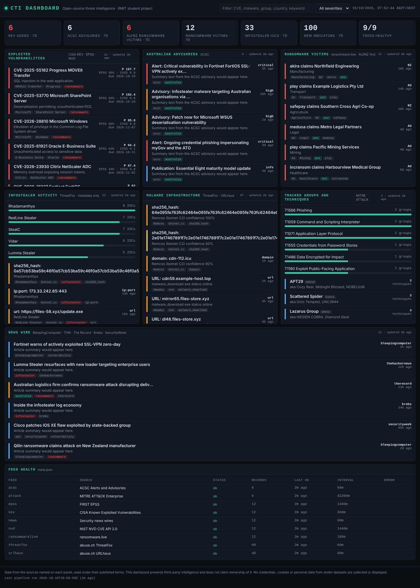

# CTI Dashboard

An open-source Cyber Threat Intelligence dashboard with automated feed aggregation.
End of semester project, RMIT Certificate IV in Cyber Security.



Live data from CISA KEV and Cybersecurity Advisories, NVD, FIRST EPSS, abuse.ch ThreatFox and URLhaus, ransomware.live,
MITRE ATT&CK and five security news wires, collected on a schedule by Python, enriched and scored,
and served as a static page from a hardened Ubuntu server on AWS.

## Quick start (laptop, no keys, no network)

```bash
git clone <this repo> && cd cti-dashboard
python3 -m venv .venv && . .venv/bin/activate
pip install -r requirements-dev.txt
python -m pipeline.make_samples        # illustrative sample data
python -m pipeline.run --sample        # builds data/*.json offline
ln -s ../data web/data                 # let the page find the JSON
python -m http.server 8000 --directory web   # open http://localhost:8000
python -m pytest -q
```

## Quick start (real feeds)

1. Get free keys: abuse.ch Auth-Key (https://auth.abuse.ch/) and an NVD API key
   (https://nvd.nist.gov/developers/request-an-api-key).
2. `cp deploy/env.example .env`, fill in the keys, then `set -a; . ./.env; set +a`.
3. `python -m pipeline.run --all` (first run takes a few minutes: NVD is rate limited).
4. Later runs: `python -m pipeline.run` only fetches feeds whose interval has elapsed.

## Repository layout

```
collectors/   one module per feed; each exposes FEED and collect(ctx)
pipeline/     run.py (collect, dedup, enrich, health), weekly_report.py, make_samples.py
web/          index.html, app.js, style.css: static dashboard, reads /data/*.json
data/         pipeline output (git-ignored) and data/samples/ (committed)
deploy/       harden.sh, install.sh, systemd units, nginx.conf, env.example
tests/        pytest suite; runs the pipeline in sample mode
docs/         schema, feed catalogue, runbook, ethics register, hardening checklist
```

## How it works

```
 feeds (JSON/RSS/CSV/STIX)                      web/
   |  collectors/*.py  (15 min timer)             |
   v                                              v
 common schema  -->  dedup  -->  enrich  -->  data/records.json  -->  Nginx  -->  browser
                     (feed,id)   EPSS/CVSS     data/meta.json          (TLS)
                                 ATT&CK        data/summary.json
                                 priority
```

Every record has the same shape (see `docs/schema.md`), so a new feed is a single file that
returns a list of records. The dashboard needs no change to show it in the panel for its type.

Priority for vulnerabilities (refine this in Week 4): `50 if KEV + 40 * EPSS + CVSS + 10 if ransomware`.

## Server deployment (AWS EC2, Ubuntu 24.04)

```bash
# on a fresh instance, as root
sudo bash deploy/harden.sh <admin-user> "<ssh public key>"      # ADMIN_CIDRS="x.x.x.x/32" to lock SSH down
# as the admin user
sudo git clone <this repo> /srv/cti/checkout && cd /srv/cti/checkout
sudo nano /etc/cti/env                                           # add keys
sudo bash deploy/install.sh                                      # venv, systemd timers, nginx, first run
sudo certbot --nginx -d dashboard.example.edu.au                 # TLS
```

Security group: inbound 443 from anywhere, 80 from anywhere (certbot), 22 from your IP ranges only.
The pipeline runs as the unprivileged `cti` user under systemd with `ProtectSystem=strict`, writing
only to `/srv/cti/data`. Nginx serves `web/` and exposes `/srv/cti/data` read-only at `/data/`.

Pushing to `main` runs the tests and, if they pass, deploys over SSH (see `.github/workflows/ci.yml`;
set `DEPLOY_HOST`, `DEPLOY_USER`, `DEPLOY_SSH_KEY` as repository secrets).

## Adding a feed

1. Copy `collectors/acsc.py` to `collectors/<id>.py`, set `FEED`, implement `collect(ctx)`.
2. Add a sample file `data/samples/<id>.json` (or extend `pipeline/make_samples.py`).
3. Add the id to `RECORD_FEEDS` in `pipeline/run.py`.
4. Add a row to `docs/feed-catalogue.md` with licence terms and the fields you retain.
5. If the feed touches stolen or personal data, add an entry to `docs/ethics-register.md` first.

## Ethics and legal

Infostealer and breach sources are ingested as metadata and aggregate statistics only. No usernames,
passwords, cookies, tokens or personal identifiers are stored, logged or displayed, and
`tests/test_pipeline.py::test_infostealer_data_is_metadata_only` fails the build if they appear.
Every panel names its source and the data is used under each source's published terms.

## Licence

MIT. Third-party intelligence remains the property of its publishers.
